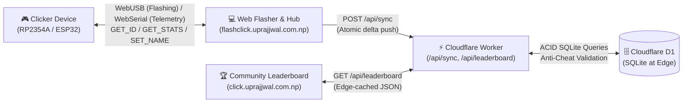

# Clicker Project 🎮

Official repository for the Clicker handheld device ecosystem, encompassing production firmware, hardware schematics, PCB designs, CAD enclosure models, automated asset build pipelines, and browser-based WebUSB & WebSerial flashing tools.

---

## 📁 Repository Structure

```text
Click/
├── README.md                          <-- Master documentation and system overview
├── PROJECT_RULES.md                  <-- Protected subsystems, NVS rules & coding freeze
├── CHANGELOG.md                      <-- Comprehensive release history & architecture decisions
├── LICENSE                           <-- CC BY-NC-SA 4.0 International License
├── platformio.ini                    <-- PlatformIO configuration & automated build flags
├── build_release.bat                 <-- 1-Click Interactive firmware release packager
├── run_flasher.bat                   <-- 1-Click Localhost web flasher server runner
├── flash_device.bat                  <-- 1-Click Desktop CLI serial flasher
├── hardware/                         <-- Electrical schematics, 3D mechanical designs & production files
│   ├── Enclosure/                    <-- CAD enclosure assembly and 3D printable parts
│   │   ├── Assem4.SLDASM             <-- SolidWorks master enclosure assembly
│   │   ├── Click 4.SLDPRT            <-- SolidWorks case part model
│   │   ├── Click4_PCB.SLDPRT         <-- SolidWorks PCB envelope reference
│   │   └── STLs/                     <-- Production 3D-printable stereolithography meshes
│   │       ├── Case.STL              <-- Main device housing
│   │       ├── Case for Hook.STL     <-- Device housing with keychain/lanyard loop
│   │       ├── Back Plate w window.STL <-- Back cover with sensor/battery window
│   │       └── Back Plate w Hook.STL   <-- Back cover with keychain anchor
│   ├── PCB/                          <-- KiCad PCB manufacturing & CAD files
│   │   ├── Click4/                   <-- Active production PCBA (Raspberry Pi RP2354A)
│   │   │   ├── Click4.kicad_sch      <-- Production PCBA schematic
│   │   │   ├── Click4.kicad_pcb      <-- 4-layer impedance-controlled PCB layout
│   │   │   ├── Click4.step           <-- 3D MCAD export for enclosure fit check
│   │   │   └── production/           <-- JLCPCB Gerbers, drill files, BOM & CPL
│   │   ├── Click1/                   <-- Legacy prototype KiCad PCB & schematic (ESP32-WROOM-32E)
│   │   └── Resources/                <-- Edge cut DXFs, silkscreen vector artwork & graphics
│   ├── V4 Production Files/          <-- Ready-to-order manufacturing packages
│   │   ├── for JLCPCB.zip            <-- PCBA fabrication & assembly production archive
│   │   └── for JLC3DP.zip            <-- 3D printing enclosure fabrication archive
│   └── vector_designs.ai             <-- Vector graphics & enclosure laser engraving artwork
├── server/                           <-- Cloudflare Worker + D1 Serverless Leaderboard Backend
│   ├── worker.js                     <-- Edge API routes (/api/leaderboard, /api/sync, /api/user)
│   ├── schema.sql                    <-- D1 SQLite schema (devices, global_stats, sync_log)
│   ├── wrangler.toml                 <-- Cloudflare Worker deployment configuration
│   └── README.md                     <-- 3-minute zero-cost deployment guide
├── firmware/                         <-- Modular C++ embedded firmware
│   ├── assets/screens/               <-- 1-bit screen bitmaps & sprites (.png) + README.md
│   ├── scripts/
│   │   ├── pre_build_assets.py       <-- PlatformIO pre-build hook (auto-converts assets)
│   │   ├── convert_assets.py         <-- Converts PNGs to C PROGMEM bitmap headers
│   │   ├── flash.sh                  <-- Flashing utility for macOS / Linux
│   │   └── flash.bat                 <-- Flashing utility for Windows
│   └── src/                          <-- Application source code & applets
│       ├── main.cpp                  <-- Application entry point, serial protocol & registry
│       ├── system/                   <-- Core OS, drivers & power management (untouched by applets)
│       │   ├── Applet.h              <-- Base class interface for all applets
│       │   ├── OSManager.h / .cpp    <-- Applet scheduler & 3-stage sleep lifecycle
│       │   ├── PowerManager.h        <-- 12MHz XOSC sleep, __wfi(), double-click wake & I2C safety
│       │   ├── PinConfig.h           <-- Authoritative pin routing (RP2354A & ESP32)
│       │   ├── Display.h             <-- SSD1306 OLED singleton & 400kHz fast I2C
│       │   ├── InputManager.h / .cpp <-- Debounced button state machine & dual-key readers
│       │   ├── battery.hpp           <-- Non-linear LiPo curve, ADC filter & ETA6003 STAT
│       │   ├── WS2812.h              <-- PIO driver for 2x SK6812 RGB LEDs (GP11 DIN)
│       │   ├── SoundFX.h             <-- Non-blocking audio buzzer driver (GP27)
│       │   ├── HardwareDiagnostics.h / .cpp <-- Interactive & automated hardware test suite
│       │   └── device_info.hpp / .cpp<-- RP2354 Unique Board ID / eFuse MAC & custom bootscreen name
│       ├── applets/                  <-- Self-contained, modular games & apps
│       │   ├── clicker/              <-- Sisyphus uphill clicker game & physics engine
│       │   ├── timing_game/          <-- "Just 10 Seconds" accuracy timing game
│       │   ├── flappy_bird/          <-- Flappy Bird arcade obstacle game
│       │   ├── settings/             <-- Hardware status, voltage & device ID screen
│       │   └── screensaver/          <-- Snowfall particle animation on idle
│       ├── fonts/                    <-- Custom Adafruit GFX typography headers (Rajdhani)
│       ├── screens/                  <-- Legacy milestone overlay renderers
│       └── generated_assets/         <-- Auto-generated C bitmap headers
├── web_flasher/                      <-- WebUSB & WebSerial flasher, personalizer & leaderboard site
│   ├── index.html                    <-- Modern WebUSB/WebSerial application entry point
│   ├── flasher.html                  <-- Full-featured standalone flasher UI
│   ├── app.js                        <-- WebSerial engine, personalization & leaderboard sync
│   ├── rp2350-flash.js               <-- In-browser WebUSB Picoboot flasher & BOOTSEL flow
│   ├── rp2350-flash.css              <-- WebUSB installer & modal responsive styling
│   ├── style.css                     <-- Cyberpunk terminal responsive styling
│   ├── lib/                          <-- In-browser flashing drivers
│   │   ├── picoboot/                 <-- Native WebUSB Picoboot protocol driver (RP2350/RP2354)
│   │   └── uf2.js                    <-- Browser UF2 binary encoder/decoder
│   ├── flash-rp2350.bat / .sh        <-- Desktop Picotool update helper scripts
│   ├── manifest.json                 <-- WebSerial firmware manifest
│   ├── versions.json                 <-- Release catalog with hashes and download links
│   ├── releases/                     <-- Multi-version release archive (v0.1.1, v0.1.0, v0.0.1)
│   └── README.md                     <-- Web flasher guide, WebUSB/WebSerial docs & hosting
├── tools/                            <-- Build & developer utilities
│   ├── release/release_manager.py    <-- Interactive version bumper & binary packager
│   ├── flasher/                      <-- Flasher runner & desktop CLI scripts
│   │   ├── serve_flasher.py          <-- Zero-config HTTP server for web_flasher
│   │   └── flash_device.py           <-- Desktop serial flasher script
│   └── converters/                   <-- TTF font and image conversion scripts
└── docs/                             <-- Architectural specifications
    ├── hardware_and_pinouts.md       <-- Detailed pin profiles (RP2354A vs ESP32)
    ├── power_management_and_battery_architecture.md <-- Power optimization, battery fuel gauging & sleep currents
    ├── device_identification_and_leaderboard.md <-- Unique hardware ID & database schema
    └── leaderboard_architecture.md   <-- Cloudflare Worker API & score sync model
```

---

## ⚡ Hardware Platforms & Pin Profiles

Detailed technical schematics and electrical specifications can be found in [`docs/hardware_and_pinouts.md`](docs/hardware_and_pinouts.md).

> [!NOTE]
> **Active Hardware & Production Platforms**:
> - **Active Production Platform (Click 4 - RP2354A)**: Turnkey PCBA featuring the **Raspberry Pi RP2354A** MCU (Dual Cortex-M33, 512KB RAM, 4MB Flash). Features high-precision calibrated Li-Ion battery telemetry, 12MHz active sleep with $< 1\text{ mA}$ power consumption, dual SK6812 RGB LEDs, piezo sound, and PCF8563 RTC. Active default build environment: `env:rp2354`. Design files in `hardware/PCB/Click4/`.
> - **Legacy Prototype (Click 1 - ESP32-WROOM-32E)**: Hand-assembled prototype board maintained for backward compatibility under `env:esp32doit-devkit-v1`. Design files in `hardware/PCB/Click1/`.
> - **Power & Battery Deep-Dive**: For full architectural documentation on power management, battery discharge modeling, and silicon gotchas, read [**`docs/power_management_and_battery_architecture.md`**](docs/power_management_and_battery_architecture.md).

### Active Production Hardware Specs (Click 4: RP2354A)
- **Microcontroller**: Raspberry Pi RP2354A (Dual Cortex-M33 @ 48MHz, 512KB SRAM, 4MB on-chip Flash)
- **Display & RTC I2C Bus**: `CLICK_I2C = Wire1` (SDA = GP2, SCL = GP3, 400kHz Fast I2C)
- **User Inputs**: MODE = GP0 (Active LOW), ACTION = `BOOTSEL` / `QSPI_SS` (Active LOW)
- **Power & Battery**: STAT = GP1 (Active LOW charging from ETA6003 with 10k pullup), BAT_ADC = GP29 (ADC3 via 100k/100k divider)
- **Audio & Visual**: Buzzer = GP27 (via NPN BJT), RGB LEDs = GP11 (2× SK6812 DIN via PIO)
- **Power Management**: Same-Button Double-Click Wake protection (double-clicking the same key within 500ms), 3-stage sleep profile (8s dim, 15s display off, 30s deep sleep at 12MHz down-clocking $< 1\text{ mA}$), I2C bus preservation (0µA idle)

### Legacy Prototype Specs (Click 1: ESP32-WROOM-32E)
- **Microcontroller**: ESP32-WROOM-32E (Xtensa Dual-Core 240MHz, 4MB Flash)
- **Display I2C**: SDA = GPIO 21, SCL = GPIO 22 (400kHz Fast I2C)
- **User Inputs**: MODE = GPIO 14 (RTC ext0 wake), ACTION = GPIO 32 (RTC ext1 wake)
- **Power & Battery**: STAT = GPIO 33, BAT_ADC = GPIO 35 (100k/100k divider)
- **Sleep States**: Light sleep at 20s (OLED off, I2C pullups held), Deep sleep at 45s (RTC wakeup)

---

## 🕹️ Applet Ecosystem & Gameplay

The firmware features an event-driven `OSManager` hosting four built-in applets and an idle screensaver:

### 1. Sisyphus Clicker (Default Applet)
* **Theme**: Sisyphus rolling his eternal boulder up a steep mountain slope.
* **Dynamics**:
  * **Boulder Physics**: Smooth rotation and position tracking based on player clicks.
  * **Stamina & Fatigue**: Continuous clicking builds fatigue; stopping causes Sisyphus to catch his breath.
  * **Auditory Feedback**: 3 short beeps when the boulder rolls back downhill, with a gentle chime upon hitting bottom. Silent on startup into Sisyphus.
  * **Milestone Celebrations**: Overlay banners and RGB celebration pulses trigger on reaching milestone tiers.
  * **Persistence**: Dual-key NVS backup storage with checksum verification and wear-leveling.

### 2. Just Ten
* Precision stopwatch game challenging players to hold and release the button at exactly **10.0000 seconds**.
* Displays exact millisecond accuracy, tracks personal records, and flashes yellowish LEDs upon stopping.

### 3. Flappy Bird
* Real-time side-scrolling obstacle game featuring obstacle collision detection, velocity physics, and persistent high scores with red LED flash on game over.

### 4. Settings & System Applet
* Accessible by holding the **MODE** button.
* **Page 0 (SYSTEM)**: Shows live battery state (`[CHARGING]`, `[BATTERY]`, `[CHARGED]`), high-precision numerical voltage (`x.xxV`), and a graphical charge bar.
* **Page 1 (SYSTEM INFO)**: Center-aligned hardware telemetry displaying Firmware version, unique Device ID, and MCU specifications.

### 5. Snowfall Screensaver
* Ambient particle simulation that activates automatically when the device remains idle prior to entering sleep.

---

## 🎮 Controls & Navigation Guide

| Action | Control | Description |
|:---|:---|:---|
| **Cycle Applets** | `MODE` Button (Short Press) | Switch between **Clicker**, **Just Ten**, and **Flappy Bird** (click chime plays except before Sisyphus). |
| **Settings Menu** | `MODE` Button (Hold > 1s) | Toggle between the currently active applet and the **SYSTEM** settings screen. |
| **Toggle System Info** | `ACTION` Button (in Settings) | Toggle between Battery Telemetry (Page 0) and System Info (Page 1) screens. |
| **Primary Game Action** | `ACTION` Button (Short Press) | Push boulder in Sisyphus / Flap wings in Flappy Bird / Start & Stop in Just Ten. |
| **Wake from Sleep** | **Same-Button Double-Click** (two clicks on the same key within 500ms) | Wakes the device from low-power sleep back to the Sisyphus game (filters accidental single clicks & cross-key bumps). |
| **Factory Master Reset** | **Both Buttons Held** (> 4s) | Trigger master reset / clear NVS partitions and milestone progress. |


---

## 🛠️ Adding New Applets (Developer Guide)

The system firmware (`firmware/src/system/`) provides an isolated runtime environment. You or any contributor can add new games or micro-apps without touching, altering, or risking the core OS, sleep managers, or display drivers:

1. **Create an Applet Folder**: Create a directory in `firmware/src/applets/` (e.g., `firmware/src/applets/snake/`).
2. **Implement the `Applet` Interface**:
   ```cpp
   #pragma once
   #include "system/Applet.h"
   #include "system/Display.h"

   class SnakeApplet : public Applet {
   public:
       void init() override { /* Setup game state */ }
       void update() override { /* Real-time physics / tick loop */ }
       void draw() override { /* Draw frame on display */ }
       void cleanup() override { /* Teardown temporary state */ }
       void onActionClick() override { /* Handle ACTION button press */ }
   };
   ```
3. **Register in `firmware/src/main.cpp`**:
   ```cpp
   #include "applets/snake/SnakeApplet.h"
   SnakeApplet snakeApplet;

   // In setup():
   osManager.registerApplet(&snakeApplet);
   ```

All input debouncing, display clocking (400kHz Fast I2C), light sleep (15s), deep sleep (30s), and button wakeups continue working automatically in the background.

---

## 🚀 Building, Flashing & Updating

### 1. Web Flasher (Recommended)
* **Online**: Connect your device and visit [flashclick.uprajjwal.com.np](https://flashclick.uprajjwal.com.np).
  * **Click 4 (RP2354A)**: Hold the `ACTION` button (`BOOTSEL`) while plugging in USB-C, then click **Connect & Install Firmware** to flash directly via in-browser **WebUSB (Picoboot)**. No local drivers or utilities needed.
  * **Click 1 (ESP32)**: Connect via USB-C and flash directly via **WebSerial** using ESP Web Tools.
  * **Live Renaming & Community Boulder Sync**: Connect at runtime via WebSerial (115200 baud) to auto-detect device ID, personalize your custom bootscreen name, and sync clicks to the global leaderboard.
* **Local Server**: Double-click [`run_flasher.bat`](run_flasher.bat) or run:
  ```bash
  python tools/flasher/serve_flasher.py
  ```

### 2. Desktop Command-Line Flashing
* **Windows**: Run [`flash_device.bat`](flash_device.bat).
* **macOS / Linux**:
  ```bash
  chmod +x firmware/scripts/flash.sh
  ./firmware/scripts/flash.sh
  ```

### 3. Building via PlatformIO
The project uses PlatformIO with an automated asset compilation hook:
```bash
# Compile firmware for Click 4 (Raspberry Pi RP2354A - Default target)
pio run -e rp2354

# Compile with interactive Hardware Diagnostics Suite enabled
pio run -e rp2354-debug

# Compile for legacy prototype (ESP32-WROOM-32E)
pio run -e esp32doit-devkit-v1

# Upload directly over USB serial
pio run --target upload

# Open serial monitor (115200 baud)
pio device monitor -b 115200
```

### 4. Automated Asset Pipeline
Screen graphics placed in `firmware/assets/screens/` are converted to C headers before every compile:
```bash
python firmware/scripts/convert_assets.py
```

### 5. Official Release Packaging
To build an official release, bump semantic versions, and generate multi-target binary packages (UF2 + BIN):
```bash
# Windows
.\build_release.bat

# Python direct
python tools/release/release_manager.py
```

## 🌐 Community Leaderboard & Edge Cloud Architecture

The Click ecosystem features a fully connected, zero-maintenance, zero-cost ($0/month) serverless stack running on **Cloudflare Workers** and **Cloudflare D1 (Serverless SQLite)**:



### 1. The "Community Boulder" Mechanic 🪨
* Unlike isolated single-player games, every single click registered on any Clicker device contributes to the **Global Community Boulder**.
* When players connect to the Web Flasher and sync their device, their delta clicks are atomically added to `global_stats.total_boulder_clicks`.
* The live web interface visualizes the worldwide community progress as one shared mountain ascent.

### 2. Anti-Cheat & Physical Rate Limiting 🛡️
* The Cloudflare Worker enforces strict human-velocity checks on every sync request:
  * Delta clicks are validated against elapsed time between syncs (enforcing a physical maximum cap of ~15–20 clicks per second).
  * Excessive or impossible spikes are flagged and rejected, ensuring the Community Boulder and leaderboard rankings remain authentic.
  * Every sync transaction is immutably audited in the `sync_log` table with delta claims and hash signatures.

### 3. Device Personalization & Custom Bootscreen ✨
* Clickers are uniquely identified by their hardware silicon signature:
  * **Raspberry Pi RP2354A**: Permanent 16-character hex Unique Board ID queried via `pico_get_unique_board_id()` (e.g. `E6614104033C71BF`).
  * **ESP32-WROOM-32E**: Factory 12-character hex eFuse MAC address via `ESP.getEfuseMac()` (e.g. `3C71BF89A1B2`).
* Through the Web Flasher interface, players can set or personalize their custom owner name (e.g. `"Prajjwal's Click"`).
* Custom names can be baked into binary firmware via magic rodata signatures (`CLICK_NAME_MAGIC_PREFIX`) or saved persistently to NVS storage (`clicker_cfg` namespace).
* Upon boot, the physical SSD1306 OLED screen proudly renders the personalized owner name on the boot splash screen.

### 4. Interactive Serial Telemetry Protocol 🔌
The firmware exposes a high-speed telemetry interface over USB CDC serial (115200 baud) for browser-based synchronization:
* `GET_STATS` / `STATS` &rarr; Flushes active clicks to storage and returns structured JSON telemetry:
  `{"event":"stats","name":"CLICKER","chip_id":"...","clicks":35200,"flappy":42,"just_ten":10.004,"uptime_hrs":12}`
* `SET_CLICKS <val>` &rarr; Sets lifetime click count and returns:
  `{"event":"clicks_updated","clicks":<val>}`
* `SET_STATS CLICKS=<n> FLAPPY=<n> JUST_TEN=<f>` &rarr; Restores all mini-game scores and returns:
  `{"event":"stats_restored","clicks":<n>,"flappy":<n>,"just_ten":<f>}`
* `PING` &rarr; Returns heartbeat response: `{"event":"pong"}`

### 5. Live Links & Deployment
* **Live Community Leaderboard**: [click.uprajjwal.com.np](https://click.uprajjwal.com.np)
* **Web Flasher & Device Hub**: [flashclick.uprajjwal.com.np](https://flashclick.uprajjwal.com.np)
* **Backend Source & Deployment Guide**: [`server/README.md`](server/README.md)

---

## ⚖️ License

This project (Firmware, PCB schematics & layouts, 3D mechanical designs, and assets) is licensed under the **Creative Commons Attribution-NonCommercial-ShareAlike 4.0 International License ([CC BY-NC-SA 4.0](LICENSE))**.

* **Personal & Educational Use**: ✅ You are welcome to view, modify, download, and fabricate units for your personal, non-commercial use.
* **Commercial Manufacturing & Sale**: ❌ Manufacturing, assembling, packaging, or selling physical units, kits, PCBs, or parts for commercial gain is strictly prohibited without prior written permission from the author.
* See [LICENSE](LICENSE) for complete terms.


